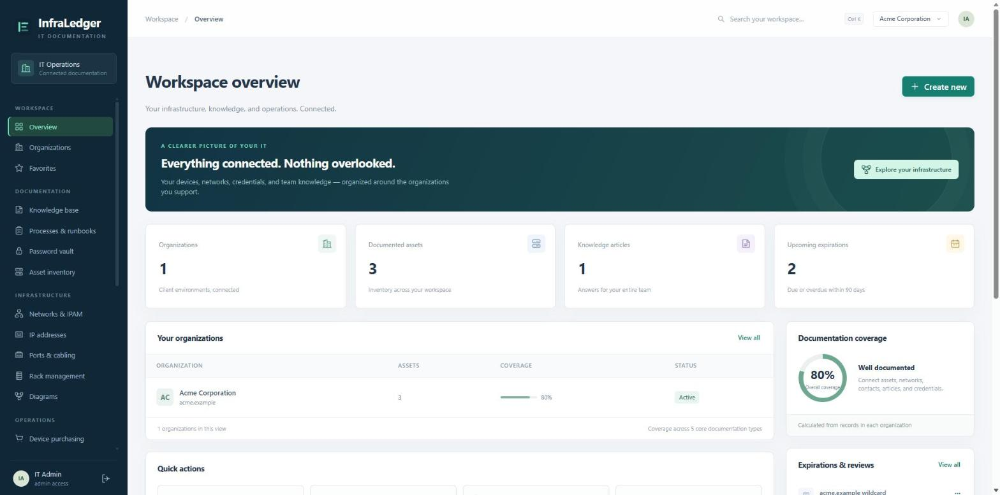
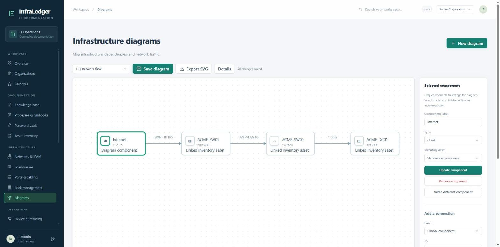
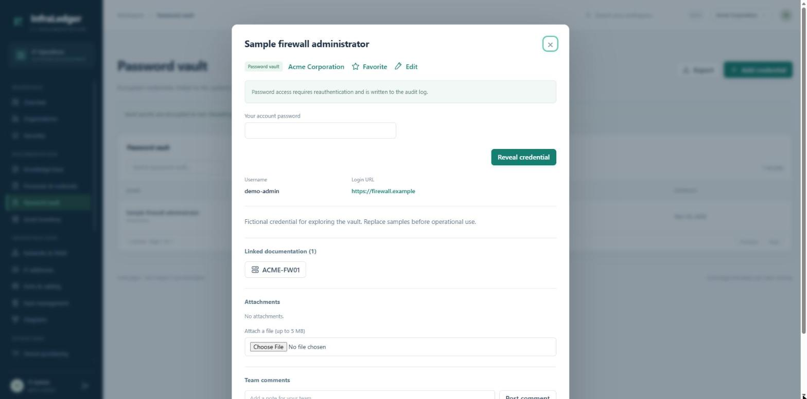
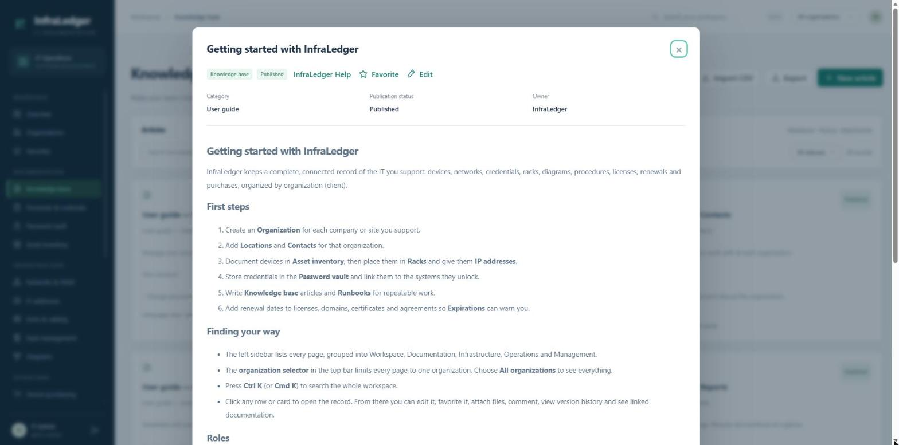

<p align="center">
  <picture>
    <source media="(prefers-color-scheme: dark)" srcset="docs/assets/logo-dark.svg">
    
  </picture>
</p>

<p align="center">
  <strong>All your IT documentation in one secure, self-hosted place.</strong><br>
  Devices, networks, passwords, racks, diagrams, runbooks, licenses and renewals: one connected record for every organization you support.
</p>

<p align="center">
  
  
  
  
  
</p>

<p align="center">
  <a href="#features">Features</a> ·
  <a href="#screenshots">Screenshots</a> ·
  <a href="#quick-start">Quick start</a> ·
  <a href="#user-guide">User guide</a> ·
  <a href="#security">Security</a> ·
  <a href="#backup-and-recovery">Backup</a>
</p>



## What is InfraLedger?

InfraLedger is the **ledger for your infrastructure**: a self-hosted workspace where IT teams and managed service providers record everything about the systems they run, and see how it all connects.

Instead of passwords in one tool, network notes in a wiki, rack layouts in a spreadsheet and renewal dates in someone's calendar, InfraLedger keeps them together, organized by **organization** (client, company or site). Every record can link to related records: a firewall links to its credentials, its rack position, its IP addresses, its switch ports and the diagram it appears in.

It runs as a **single Go binary** with an embedded SQLite database. There's no external database or cloud service to set up, and your data stays on your server.

## Features

### 📚 Documentation
- **Knowledge base:** Markdown articles with version history, restore, review dates, attachments and team comments
- **Processes & runbooks:** checklists that track progress and complete themselves when every step is done
- **Client sharing:** mark records **Client visible** to share them with that client's users; internal comments stay private

### 🔐 Password vault
- Credentials **encrypted at rest** (AES-256-GCM) and never returned by the API
- Revealing a secret requires **re-entering your password** (and MFA code), is **audited**, and auto-hides after 30 seconds
- Stored TOTP seeds generate live authenticator codes; built-in strong password generator

### 🖥️ Inventory & procurement
- **Asset inventory** with lifecycle status, warranty dates, costs and **custom fields** from asset templates
- **Device purchasing:** Draft → Submitted → Approved → Ordered → Received, then receiving creates the devices in inventory automatically

### 🌐 Infrastructure
- **Networks & IPAM** with CIDR validation, gateway checks and duplicate-free IP allocation
- **Ports & cabling** between devices, with cable IDs and VLANs
- **Rack management** with unit-by-unit elevations and overlap/capacity validation
- **Diagrams:** a drag-and-drop editor for topologies and traffic flows, with components linked to real assets and SVG export

### 📅 Operations
- Vendors, software licenses, domains, certificates, agreements, locations and contacts
- **Expirations:** every warranty, renewal, certificate, password rotation and review due in the next 90 days, in one list
- **Reports:** inventory value, open orders, articles due for review, license seats and rack utilization

### 🛡️ Management
- Roles: **Admin**, **Editor**, **Viewer**, **Client**, with per-organization access
- Authenticator-app **MFA**, 8-hour sessions, login rate limiting
- **Audit log** of sign-ins, changes and secret access
- **Recycle bin** with link-aware restore
- **CSV import/export** (validated as a whole before saving), JSON export and a **read-only API** with revocable tokens
- **Built-in user guide:** a knowledge base article for every page, installed automatically

## Screenshots

| Diagram editor | Password vault |
| --- | --- |
|  |  |

| Built-in user guide |
| --- |
|  |

## Quick start

**Requirements:** Go 1.25+ and Node.js 22.5+

```sh
git clone https://github.com/yashwanta/InfraLedger.git
cd InfraLedger
npm install
npm run build             # React UI -> dist/
npm run build:server      # Go server -> outputs/infraledger.exe
outputs/infraledger.exe   # open http://127.0.0.1:5173
```

On first visit, create the administrator account. You can include fictional sample records to explore, and the user guide is added to the knowledge base automatically.

**Development:** run `npm start` (Go API on :5173) and `npm run dev` (Vite with hot reload on :5175, proxying `/api`).

### Configuration

| Flag / env var | Default | Purpose |
| --- | --- | --- |
| `-addr` / `LISTEN_ADDR` | `127.0.0.1:5173` | HTTP listen address |
| `-data` / `DATA_DIR` | `data` | Database, vault key and attachments |
| `-static` / `STATIC_DIR` | `dist` | Built React UI |
| `APP_ORIGIN` | — | Allowed origin when served behind a proxy |
| `APP_TIMEZONE` | `America/New_York` | Time zone for due dates and expirations |
| `COOKIE_SECURE=1` | off | Mark session cookies `Secure` (set when serving over HTTPS) |
| `VAULT_KEY` | `data/vault.key` | Base64 32-byte vault key, instead of the key file |

For anything beyond local use, serve InfraLedger over HTTPS, for example behind a reverse proxy, and set `COOKIE_SECURE=1`.

### Read-only API

Admins create API tokens in **Settings → Manage API tokens**. Tokens expire after 30 days, can read records and exports, and can never change data or reveal secrets.

```sh
curl -H "Authorization: Bearer <token>" http://127.0.0.1:5173/api/records?type=assets
```

## User guide

Every page has a guide in [`docs/kb/`](docs/kb). Start with [Getting started](docs/kb/00-getting-started.md).

The guides are compiled into the server and installed as knowledge base articles under the **InfraLedger Help** organization:

- automatically when a new workspace is created, and
- from **Settings → Install / update user guide** (admins), which adds missing guides and restores edited ones to the shipped text as a new version. Your own articles are never changed.

To change a guide, edit its Markdown file (it must start with a `# Title` line), rebuild the server and use the Settings button.

## Security

- **Passwords:** PBKDF2-SHA256 with 600,000 iterations and a per-user salt
- **Vault:** AES-256-GCM with a random nonce per value; the key lives in `data/vault.key` or `VAULT_KEY`
- **Sessions:** HttpOnly, SameSite=Strict cookies plus a CSRF token on every change; cross-origin writes are rejected
- **Headers:** strict Content-Security-Policy, `X-Frame-Options: DENY`, `nosniff`, `no-store`
- **Access:** server-side role and organization checks on every request; clients never see internal comments
- **Accountability:** audit log for sign-ins, changes, exports and every secret reveal

## Project structure

```
cmd/infraledger/   Server entry point (flags, graceful shutdown)
internal/app/      REST API, storage, validation, vault, user-guide installer
docs/kb/           User guide, one Markdown file per page (embedded in the binary)
web/src/           React + TypeScript frontend
tests/             API test suite and harness that runs it against the Go binary
```

## Tests

```sh
npm test               # Go unit tests + full API suite against the Go server
npm run test:go-unit   # go test ./...
npm run test:api       # tests/app.test.mjs against a freshly built Go binary
```

The API suite covers setup and login, CSRF, vault encryption and re-authentication, roles and client isolation, IPAM and rack validation, purchasing, diagrams, attachments, import rollback, the recycle bin, API tokens, MFA, password changes and restart persistence. Set `INFRALEDGER_BIN` to reuse an existing build.

## Backup and recovery

The vault key encrypts every stored credential and MFA seed. **Back up and restore the database and the vault key together**; a database without its key cannot reveal secrets.

1. Stop the server so SQLite flushes its write-ahead log.
2. Copy the entire data directory (`infraledger.sqlite` with its `-wal` and `-shm` files, and `vault.key`).
3. Store the copy somewhere access-controlled; it holds encrypted secrets and the key to decrypt them.

To restore, stop the server, replace the data directory with the backup and start it again. If you use `VAULT_KEY`, back up that value separately and keep it out of source control.

Workspaces created before the project was renamed keep using their existing `trinetra.sqlite` file; no migration is needed.

**Export documentation** in Settings downloads JSON without credentials, users or attachment contents. It's useful for migration, not as a full backup.
