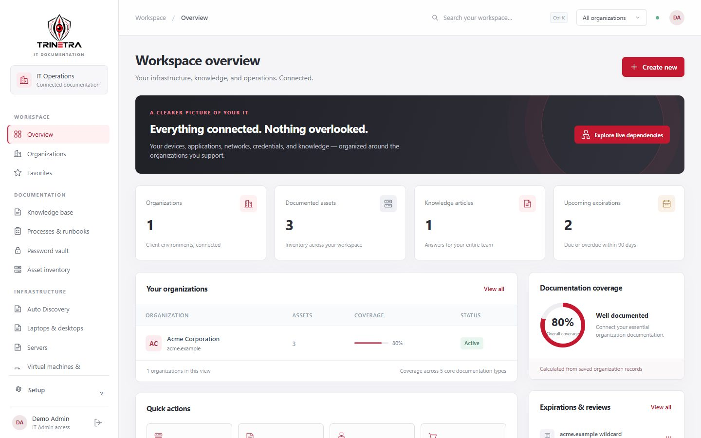
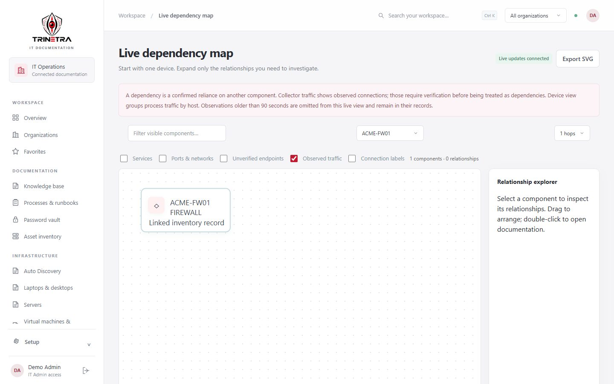
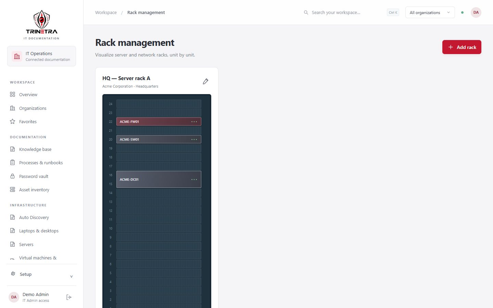
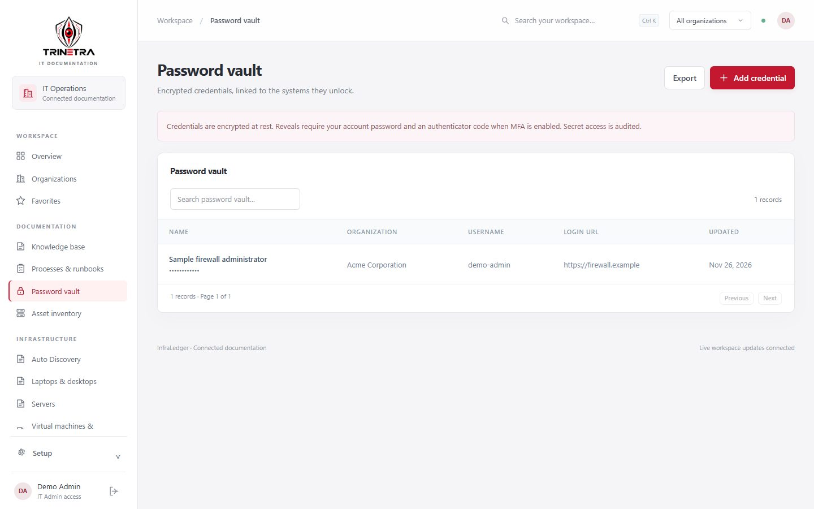

<p align="center">
  
</p>

<h1 align="center">InfraLedger</h1>

<p align="center">
  Self-hosted IT documentation, asset inventory, network discovery and live dependency mapping.<br>
  Built with <b>Go</b>, <b>React</b>, <b>TypeScript</b> and <b>SQLite</b>.
</p>

A self-hosted IT documentation application built with **Go, React, TypeScript, and SQLite**. It includes a device/application/port dependency map with server-sent updates and an optional endpoint collector.

## Screenshots

<p align="center">
  
</p>

| Live dependency map | Rack management | Password vault |
|---|---|---|
|  |  |  |

<sub>Screenshots use the built-in fictional sample data (Acme Corporation).</sub>

## Run the Windows release

1. Extract the entire Windows ZIP into a folder you control. Keep `trinetra.exe`, `collector.exe`, and `dist/` together.
2. Double-click `Start-Trinetra.cmd`, or run `trinetra.exe` from that folder.
3. Open **http://127.0.0.1:5173**.
4. Create your administrator account and enter the installation IP subnet (for example `10.20.30.0/24`). You can defer discovery configuration if needed. Subnet defaults are saved without enabling probes; install a collector and explicitly enable TCP scanning to begin network discovery. There is no default administrator password. The optional sample records are fictional.
5. Enable authenticator MFA under **Setup → General settings** and add any other users under **Setup → User Management**.

The server binds to loopback by default. Its terminal must stay open. Press Ctrl+C to stop it. Node.js and Go are not required to run the prebuilt Windows release.

## Implemented workflows

| Area | Included |
|---|---|
| Organizations | Organization records, scoped access, contacts, locations, related records |
| Inventory | Devices, manufacturers/models, serials, IPs, ownership, lifecycle states, purchase costs, warranties, custom templates |
| Passwords | AES-256-GCM encryption of passwords/TOTP seeds, password generation, reauthenticated reveal, TOTP generation, audited secret access |
| Networks | IPv4 CIDR subnets, VLANs, gateways, DNS, IP allocations, duplicate/out-of-subnet validation, port and cable documentation |
| Racks | Server/network rack elevations, device positions and heights, occupied-unit totals, overlap/capacity validation |
| Diagrams | Editable network/topology/flow diagrams, draggable nodes, labeled directional links, inventory references, saved layouts, SVG export |
| Live dependency map | Devices, applications/services, networks, physical ports, IP allocations and dependency flows; protocol/port labels; upstream/downstream focus; 1–4 hops; search; SVG export |
| Applications | Host devices, versions, listening ports, protocols, environments, owners, dependencies |
| Endpoint observation | Optional Windows/Linux collector; host facts, interfaces, subnets, neighbor-cache devices, configured TCP scanning, local processes, listening sockets, active connections; device-scoped revocable tokens; last-observed timestamps |
| Knowledge | Markdown article content, publication/review metadata, revisions and restore, attachments, comments, linked records, favorites |
| Processes | Editable checklists and persistent completion tracking |
| Procurement | Draft → Submitted → Approved → Ordered → Received; administrator approval; receipt creates linked inventory assets once |
| Operations | Vendors, software seats, domains, certificates, agreements, expiration/review lists, reports and exports |
| Access | IT Admin / IT Analyst / Plant IT / Users roles, per-page No access / View / Edit grants, organization/plant restrictions, legacy viewer/client compatibility, client-visible records, account disablement, MFA, hashed passwords, expiring sessions, CSRF checks |
| Data | SQLite persistence, optimistic version checks, soft deletion/restore, transactional CSV imports, CSV/JSON exports, read-only API tokens, server audit events |

This is an independently built application, not a certified IT Glue/Hudu clone or a claim of full vendor feature parity. PSA/RMM/cloud vendor connectors, SSO, mobile apps, browser extensions, secure external password-sharing links, email notifications, Office collaboration, recurring job scheduling, SNMP/LLDP topology integration, and automatic public SSL/DNS monitoring are not implemented. Expiration dates are entered documentation. The application has automated tests but has not had an independent security or penetration review.

## Live dependency map

Open **Live dependency map**. The graph is derived from:

- Network → device links from IP allocations.
- Device → physical port → connected device links from port/cabling records.
- Device → application links from application host and listening-port fields.
- Application/device → application/device links from dependency records.
- Observed listening/traffic dependencies received from collectors.

Choose a node, use **Focus dependencies**, and select a hop count to inspect the surrounding system. Protocol and destination port labels show how components interact. Double-click a graph node to open its documentation. Dragging the derived map changes the current view only; saved manual layouts belong in **Diagrams**.

The browser subscribes to `/api/events`. Saved changes trigger a refresh in other open workspaces without a reload. Documentation updates are immediate; collector observations follow the configured interval (30 seconds by default). Observations older than 90 seconds are labeled stale. Historical observations remain in the documentation; a missing connection is not assumed to be a failed service.

## Automatic infrastructure discovery

New installations ask for the site IP subnet. Existing installations can set defaults under **Infrastructure → Auto Discovery → Installation defaults**. The test configuration uses `10.20.30.0/24`; each actual installation should supply its own subnet.

1. Create or select the organization/plant that owns the environment.
2. Open **Auto Discovery → Add discovery collector**. Choose that organization, enter a name, and leave the host selector on **Automatically create the collector host**, or select an existing inventory device.
3. Enter private IPv4 subnets and the TCP ports to test. Turn on **Enable TCP probes** only when you intend to probe those selected ranges. Choose a 5-minute to 24-hour scan interval.
4. Copy the one-time token. On the target computer, double-click `Start-Collector.cmd` in the extracted app folder and enter the token and server URL when prompted. Alternatively, open a terminal in that folder and run:

```powershell
$env:TRINETRA_TOKEN = '<device-scoped-token>'
.\collector.exe -server https://docs.example.com -interval 30s
```

For **Command Prompt (CMD)**, use the following from the extracted Trinetra-Windows folder:

```bat
set "TRINETRA_TOKEN=<device-scoped-token>"
collector.exe -server http://127.0.0.1:5173 -interval 30s
```

For **PowerShell**, use `$env:TRINETRA_TOKEN` and ` .\collector.exe` as in the example above. In either shell, the executable must be in the current folder or invoked by its full quoted path. The installation dialog includes separate shell tabs and a copy-command button. Do not add backslashes to the URL or the end of command lines.

A collector on the same computer as a loopback server can use `http://127.0.0.1:5173`. Remote collectors require HTTPS. Tokens are scoped to a device and organization, expire after 90 days, and can be revoked under **Setup → Live collectors**. Tokens are not accepted as command-line flags and HTTP redirects are rejected. `-once` sends one snapshot and exits; `-discover=false` disables discovery while retaining socket observations.

The collector automatically imports its hostname, operating system, available hardware facts, IPv4 interfaces and MAC addresses, local CIDR networks, gateways/DNS where available, neighbor-cache endpoints, processes, listening ports, and active connections. Windows uses local system information, `netstat`, `tasklist`, and `arp`; Linux uses local network interfaces, sysfs, `/proc`, and `ss`/`ip` from iproute2. Available facts depend on host permissions. It does not inspect traffic payloads or send data to a third-party service.

Scheduled TCP discovery is limited to explicitly configured private IPv4 ranges (1,024 addresses total) and up to 32 TCP ports. It uses bounded parallel connections and a 90-second scan budget; partial results are labeled. **Discover now** queues a request for the next collector check-in. A queued request is not reported as completed while the collector is offline. Local observations normally follow the reporting interval, while active network scans follow the selected schedule. Scanning can delay a report within the bounded scan budget.

Discovered interfaces populate **Ports & cabling**, local/configured subnets populate **Networks & IPAM**, addresses are associated with discovered devices, and listening services create application and dependency records. A TCP response identifies an open port; application names inferred from standard port numbers are unverified. Discovered endpoints are labeled with their source and last-seen time. Repeated reports update records without creating duplicates.

This is collector-based discovery: the browser cannot probe a LAN by itself. Devices with no response on configured ports may appear only through the neighbor cache; lack of a response is not proof a device is offline. VLAN IDs, physical rack positions, switch-port cabling, and complete L2 topology are not guessed; those require manual documentation or an authenticated SNMP/LLDP/vendor integration. Domain and certificate dates remain documented fields, rather than live public monitoring.

## User roles and page access

Open **Setup → User Management → Add user / Edit access**. The roles are **IT Admin**, **IT Analyst**, **Plant IT**, and **Users**. Existing editor/viewer/client accounts remain compatible. IT Admin has full access; IT Analyst starts with operational editing; Plant IT starts with infrastructure editing and must be assigned organizations/plants; Users start with knowledge access.

For each account choose **No access**, **View**, or **Edit** for individual pages. Role defaults can be restored, all pages can be set to View, or grants can be cleared. Permissions are enforced by the REST API and menus. View does not permit create/update/delete, comments, or attachment changes. Editing the password page also permits audited, reauthenticated secret reveals. Minimal organization names remain available for reference selectors, without granting access to organization details.

Organization restrictions apply in addition to page grants. Client accounts still only see explicitly shared records in assigned organizations. Changing access revokes the affected account's sessions and read-only tokens. Account access administration, purchase approval and discovery configuration remain IT Admin operations, even when another role has View access to their pages.

## Build from source

Requirements: **Go 1.25+** and **Node.js 22.12+** with npm. The tested environment used Go 1.27.4 and Node.js 26.13. The runtime server is Go; Node is only needed to build the UI and run the HTTP integration tests.

```powershell
npm ci
npm run build
New-Item -ItemType Directory -Path outputs -Force
go build -buildvcs=false -o outputs/trinetra.exe ./cmd/trinetra
go build -buildvcs=false -o outputs/collector.exe ./cmd/collector
.\outputs\trinetra.exe -static dist
```

Or run `Build.ps1` to build and test everything. Go modules and npm package versions are locked in `go.sum` and `package-lock.json`.

For Linux, build without `.exe` suffixes. `CGO_ENABLED=0` is supported; SQLite is provided by the pure-Go modernc driver.

Development: run `go run ./cmd/trinetra` and `npm run dev` in separate terminals. Vite serves the React app on http://127.0.0.1:5175 and proxies `/api` (including SSE) to the Go server on port 5173.

## Verify

```powershell
go test -buildvcs=false ./...
npm run build
npm run test:api
```

The API suite launches the compiled Go server in isolated temporary directories. It tests role/organization isolation, CSRF, encrypted credential handling and reauthentication, MFA, session revocation, IP/rack validation, purchase receipt idempotence, diagrams, checklists, comments, attachments, version restore, transactional imports, API/collector tokens, restart persistence, SSE signals, and telemetry deduplication. Tests create no production users or records and do not run live endpoint collection.

Browser QA confirmed React login, cross-tab dependency updates, application port creation, article editing, diagram persistence, purchasing/receipt and mobile page width. These checks used fictional data in a separate QA database.

## Server configuration

| Setting | Default / meaning |
|---|---|
| `-addr` / `LISTEN_ADDR` | `127.0.0.1:5173` (this computer only) |
| `-data` / `DATA_DIR` | `data` |
| `-static` / `STATIC_DIR` | `dist` |
| `-tls-cert`, `-tls-key` / `TLS_CERT_FILE`, `TLS_KEY_FILE` | PEM certificate and key; the server then speaks HTTPS only, marks cookies Secure and sends HSTS |
| `APP_TIMEZONE` | `America/New_York` |
| `APP_ORIGIN` | Explicit public origin when behind a reverse proxy |
| `COOKIE_SECURE` | Set `1` when an HTTPS reverse proxy is in front |
| `TRUSTED_PROXY` | IP address of that reverse proxy; only then is `X-Forwarded-For` used for sign-in limits and audit |
| `ALLOWED_HOSTS` | Extra host names (comma-separated) accepted in the `Host` header. IP addresses, `localhost`, this computer's name and the `APP_ORIGIN` host are always accepted; anything else is rejected to stop DNS-rebinding |
| `VAULT_KEY` | Optional base64-encoded 32-byte key supplied from a secret manager |
| `ALLOW_INSECURE_HTTP` | Set `1` only on an isolated test network to allow plain HTTP on a non-loopback address |

The server **refuses to start with plain HTTP on a network address**. To use InfraLedger from other computers, either start it with `-tls-cert`/`-tls-key`, or keep it on `127.0.0.1` behind an HTTPS reverse proxy with `APP_ORIGIN`, `COOKIE_SECURE=1` and `TRUSTED_PROXY` set, and allow streaming on `/api/events` with buffering disabled. A sample `deploy/Caddyfile` is included. Collectors on other computers require HTTPS; for a self-signed or internal-CA certificate pass `-ca server-ca.pem` (or `TRINETRA_CA`) to the collector.

`trinetra.exe -version` prints the commit the binary was built from; `Build.ps1` stamps it, runs `npm audit` and (when installed) `govulncheck`, and writes `outputs/SHA256SUMS.txt`.

The default SQLite deployment serves a single application instance. API database work is serialized to keep multi-record validation and transaction behavior consistent. Request bodies are read before that lock and sign-in bodies are limited to 64 KB, so a slow client cannot stall other users. This is suitable for a small self-hosted deployment; large-scale or multi-instance deployment needs further architecture and load testing.

## Sign-in protection

- Failed sign-ins are limited per source address (20) and per account (10) for 15 minutes. Password re-entry for revealing a credential, changing the password and MFA changes is limited to 5 failures per account.
- Failed sign-ins, failed MFA codes, failed reveals, failed setup codes and rate-limit hits are written to the audit log with the source address.
- Sign-in takes the same time whether or not the email exists.
- Changing the password or MFA revokes that user's API tokens as well as their sessions.
- First-run setup from another computer requires the one-time setup code printed in the server window.

## Vault key, backups and recovery

On Windows the vault key is stored as `vault.key.protected`, encrypted with Windows DPAPI for the account that runs InfraLedger. An older plain `vault.key` is converted automatically on first start and then deleted. On start the data folder is restricted to that account, SYSTEM and Administrators. A copy of the data folder alone therefore cannot decrypt the vault on another computer or account.

**Export a recovery key once and store it offline**, separate from the database backups:

```
trinetra.exe -data data -export-vault-key
```

To restore on a different computer or Windows account, restore the data folder and start InfraLedger once with the environment variable `VAULT_KEY` set to the recovery key. Losing both the protected key file (or the Windows account) and the recovery key makes vault secrets and MFA seeds unrecoverable. On Linux the key stays in `vault.key` with owner-only permissions; supply it through `VAULT_KEY` from a secret manager for stronger separation.

Stop the server and back up the **entire data directory**, including the database and any SQLite WAL/SHM files. The database contains attachments, revisions and audit history. This is server-managed encryption, not zero-knowledge encryption.

Session tokens are stored as hashes. Account passwords use PBKDF2-HMAC-SHA256 with 600,000 iterations and individual salts. Legacy scrypt password hashes from the earlier local prototype can be verified during migration. Database backups contain password hashes and encrypted credential history, so ordinary documentation exports are intentionally not a full backup.

There is no email password-reset service or MFA recovery-code flow in this release. Keep a separate administrator account available before adopting MFA operationally. Soft-deleted records can be restored; the application does not expose permanent deletion.

A copied vault password is cleared from the clipboard after 45 seconds. Windows clipboard history (Win+V) may still keep a copy; turn it off on computers used for vault access.

## REST API

Read-only tokens created in Setup → API access expire after 30 days. Send `Authorization: Bearer <token>` to `GET /api/records`, `GET /api/records/{id}`, or `GET /api/export`. Query parameters include `type`, `org`, and `q`. Secret values are never returned from these read routes. Read-only tokens cannot reveal secrets or access account administration.

Interactive changes use the session cookie and `X-CSRF-Token` returned by sign-in. Important routes include `/api/records/{id}/versions`, `/revert`, `/reveal`, `/purchase`, `/attachments`, `/comments`, `/api/import`, `/api/users`, `/api/mfa/*`, `/api/collectors`, and `/api/events`.

Collectors authenticate separately to `POST /api/telemetry`, with a token scoped to an existing host device and organization. Payload:

```json
{"connections":[{"protocol":"TCP","localAddress":"10.0.0.5","localPort":50001,"remoteAddress":"10.0.0.20","remotePort":5432,"state":"ESTABLISHED","pid":"1234","process":"application.exe"}]}
```

## Source layout

- `cmd/trinetra/`: Go server entry point.
- `cmd/collector/`: optional endpoint collector.
- `internal/app/`: REST API, SQLite persistence, cryptography, access checks, SSE and telemetry.
- `web/src/`: React/TypeScript application, forms, map and diagram components.
- `tests/`: HTTP integration tests against the Go executable.
- `dist/`: production frontend build.

The package contains no user database, vault key, preconfigured account, collector token or production credentials.

## Upgrade notes for discovery and page permissions

Stop the existing server before replacing its executable, and back up the complete data directory. Replace the binaries and `dist/`, keep the existing data folder (database and vault key), then restart. On first start a plain `vault.key` is converted to `vault.key.protected`; export a recovery key afterwards. The server adds discovery-profile storage and the user permissions column automatically. It does not reset accounts, change existing administrator roles, or remove documentation. Existing administrators are labeled IT Admin. Review access defaults and assign plants before creating new Plant IT accounts.


## Hardware, software, and services

Infrastructure has separate Laptops & desktops, Servers, Installed applications, Services & processes, Application mapping, and Live dependency map pages. Windows/Linux tags use reported OS facts. Windows device types use computer system and operating system facts; Linux chassis facts are used where available. Unclassified hardware stays in Asset inventory and can be classified manually.

The updated collector inventories Windows machine-wide uninstall registry entries (without Win32_Product) or Linux dpkg/rpm/apk packages every 15 minutes. Windows services include description, executable path, start mode, account, state, and PID. Linux systemd loaded units report name, state, and description. Managed services refresh once a minute. Network-active process observations continue at the configured interval. Unsupported service managers, portable applications, and per-user software may not appear.

Service review flags explain wildcard listeners, unresolved process names, ports commonly associated with cleartext protocols, and service executable paths in user/temporary directories. Names and port numbers do not establish identity. This is configuration review, not malware, signature, or vulnerability scanning. Service records retain historical observations; consult last-observed timestamps.

Existing collector-created process and port-service records are migrated from Applications to Services without changing their IDs or links. Manually documented applications are preserved. Restart the updated collector to populate installed software and managed service facts; older collectors continue reporting network processes.

The live map starts focused on a host, groups process traffic by host, hides unverified remote endpoints and low-level ports by default, and allows service, port, endpoint, and observed-traffic layers to be enabled. Stale observations are excluded after 90 seconds. Installed applications without documented relationships are explored in Application mapping instead of filling the live graph. Explicitly link verified services using an application's Related records field. Shared hosting does not prove process ownership. Documented dependencies represent confirmed reliance; observed connections only establish traffic.

If local permissions block CIM or Service Control Manager, the collector reports unavailable inventory in the host record. It retains network-process observations instead of presenting failed service enumeration as an empty service list. Missing software in a subsequent complete inventory is marked Not present; its documentation is retained.

Hardware pages also list local devices awaiting identification, with IP/MAC, discovery evidence, and a Review device action. Unknown endpoints are not silently labeled as servers. Search includes IP addresses. These lists use the current organization scope and record access permissions.

Enabled subnet scans can identify Proxmox VE from its public HTTPS title and pve-api-daemon header on configured TCP 8006, and infer Linux from distribution-specific SSH banners on TCP 22. SSH alone does not classify a machine as a server. Identity evidence is visible in the asset record and is explicitly unauthenticated. The collector sends no credentials or cookies and follows no redirects during fingerprinting; its dedicated public identification probe does not verify the HTTPS certificate, so this is not authenticated hardware inventory. Existing manually assigned device roles are preserved. Restart the updated collector and include 8006 in scan ports to use this identification.

Servers also shows Additional Linux hosts — server role unconfirmed. Distribution-specific SSH evidence puts otherwise unclassified hosts in this separate candidate list. It does not relabel Linux desktops, network devices, or already classified hardware as servers. Each candidate exposes its SSH banner and evidence for review.


## Review before adding discovered inventory

Auto Discovery now has an Awaiting inventory approval queue. New collector-discovered devices and Proxmox nodes/guests are Pending. Review a device and choose Approve and add to inventory. Pending devices, their guests, and linked observations are excluded from inventory views and maps until approved. Hosts must be approved before their guests. Approval records the approver and time, is idempotent, and requires asset editing permission within the organization. Further discovery updates preserve approval. Existing identified inventory remains available; previously unclassified local discovery endpoints move to review. General documentation/API exports retain the explicit approvalStatus field so pending observations remain reviewable.

## Proxmox VM and container integration

Go to Setup → Integrations → Connect Proxmox. Configure an organization, an HTTPS node URL such as https://10.20.30.120:8006, a token ID in user@realm!token-name format, and its secret. Use a dedicated read-only API account. Assign PVEAuditor at / with propagation to both the user and the privilege-separated API token. Tokens can only see resources allowed by their ACLs; the app cannot guarantee a complete cluster inventory with narrower permissions. One connection covers the visible nodes in a cluster. Separate standalone hosts need separate connections.

HTTPS trust uses system roots by default. For private certificates, provide a trusted CA PEM or an independently verified SHA-256 leaf-certificate fingerprint. Pinning verifies the exact certificate and its validity before transmitting the token; there is no accept-any-certificate option. Redirects and environment proxies are disabled for credential-bearing requests. Token secrets are encrypted using the existing vault key, never returned by the connection API, and excluded from documentation export.

The connector makes GET requests only: /api2/json/cluster/resources and each guest's qemu/lxc config endpoint. It imports QEMU guests, LXC containers, templates, runtime state, CPU, configured memory/disk capacity, configured OS type, and static/cloud-init IP where reported. It does not power on, stop, modify, or log into guests. DHCP/guest-agent addresses and applications inside guests require additional guest/collector data. Guest OS tags reflect configured guest types, not an independent inspection of the running OS. Unavailable guest configurations are reported without discarding the guest list.

The default polling interval is five minutes (configurable, minimum one minute). Sync now queues a background refresh without blocking the interface. New devices enter review; approved guests appear in Virtual machines & containers and link to their Proxmox host. VM IDs remain stable across node migration and repeated syncs. Missing API entries are marked Not reported in latest Proxmox response, never deleted automatically; disappearance can also reflect permission changes. Pausing preserves imported records. Removing a connection through the API removes its saved credentials and preserves documentation. Integration management is restricted to IT Admin. An inactive or demoted connection owner stops imports until an active administrator edits the connection.

Proxmox token/ACL documentation: https://pve.proxmox.com/pve-docs/pve-admin-guide.html#pveum_tokens
